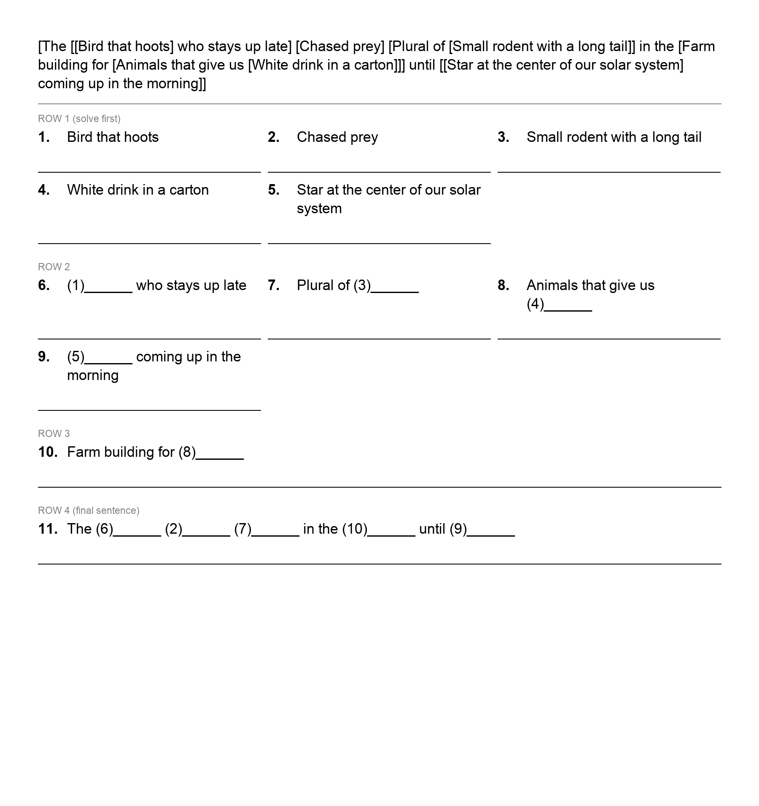
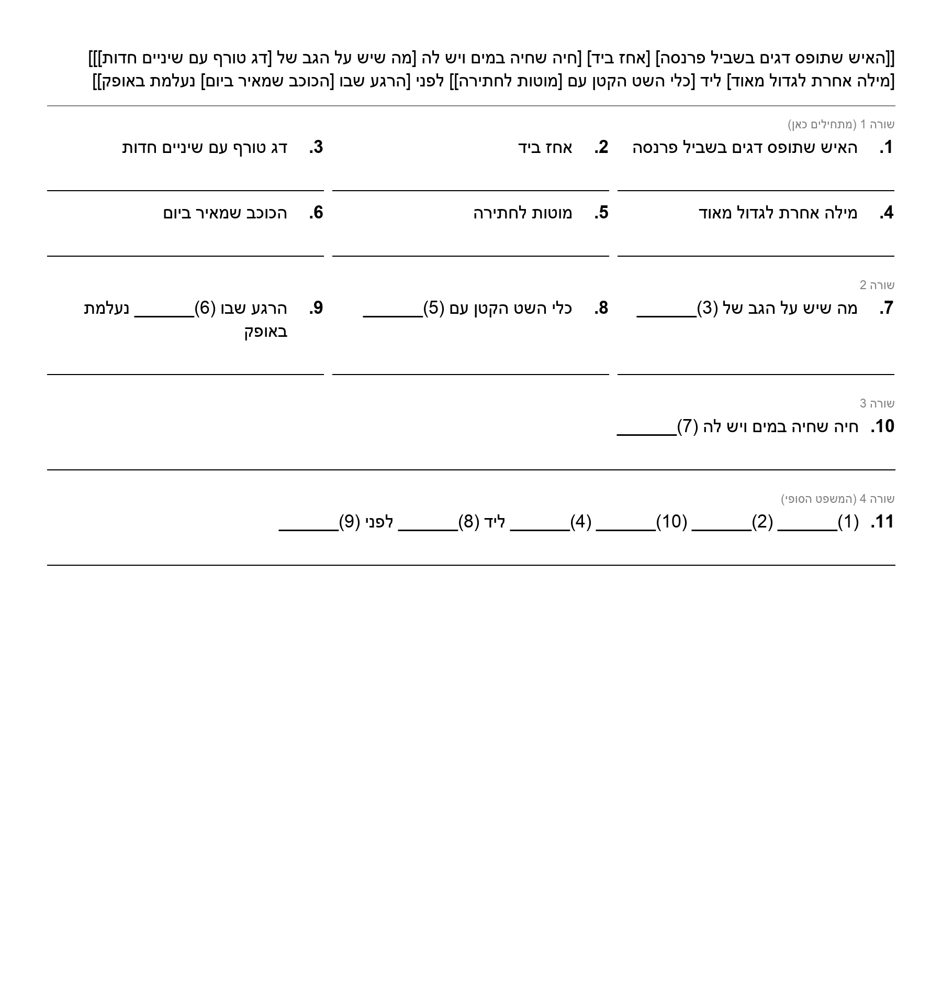

# bracket-city-paper

Turn a nested-bracket word puzzle (the kind where clues sit inside clues, like `[Farm building for [Animals that give us [White drink in a carton]]]`) into a **layered worksheet you can solve on paper**. Paste the puzzle in, get a clean picture back with one write-in line per clue. Made for printing in a school newspaper, where the original nested format leaves no room to write.

Works with **English** (left to right) and **Hebrew** (right to left, fully mirrored).

## How the worksheet works

1. The puzzle is parsed by matching its brackets, so any depth of nesting works.
2. Every bracketed clue becomes its own numbered clue with a write-in line.
3. Clues are grouped into rows by depth. **Row 1 (top) holds the innermost clues, solve those first.** Each later row only uses answers from rows above it, and the last row is the full sentence.
4. A clue that had brackets inside it shows numbered blanks like `(3)______`. Copy the answer of clue 3 into that blank.
5. The original, unformatted puzzle is shown at the top (optional).

## Quick start

```
pip install -r requirements.txt
python3 bracket_layers.py examples/inputs/english_example.txt
```

That writes `english_example_layers.png` and `english_example_layers.pdf` next to the input.

You can also run it with no file, paste the puzzle, then press Ctrl-D (Ctrl-Z then Enter on Windows):

```
python3 bracket_layers.py --out my_puzzle
```

## Options

| Option | What it does |
| --- | --- |
| `--ratio full` | Page shape. `full` = whole A4 page (default), `3/4` = three-quarter page, `1/2` = half page, or custom `width:height` like `3:4` |
| `--orientation portrait\|landscape` | Orientation of the page the presets are cut from. Default `portrait` (vertical). A custom `width:height` is used exactly as typed |
| `--font NAME_OR_PATH` | Font, by name (`"Times New Roman"`) or by path to a `.ttf`/`.otf` file. Default: **Gisha** for Hebrew, **Arial** otherwise. If the default isn't installed, it falls back to Arial for Hebrew, then to whatever font it can find, and says so. A font you ask for by name that isn't found is an error. For Hebrew, pick a font that has Hebrew letters |
| `--no-original` | Leave the original puzzle out of the picture (shown at the top by default) |
| `--direction auto\|rtl\|ltr` | Layout direction. Default `auto` switches to right-to-left if the puzzle contains Hebrew |
| `--cols N` | Max clues side by side in a row (default 3) |
| `--width PIXELS` | Picture width (default 1800) |
| `--font-size PIXELS` | Starting text size (default 34) |
| `--out PREFIX` | Output file name prefix |
| `--text` | Also write a tab-separated text version, for pasting into a document |

About the page ratio: the width stays fixed and the height follows the ratio. If the puzzle is shorter than the page, it stays at the top and the rest is blank. If it is too long, the text shrinks until it fits. If it can't fit even at the smallest size, the picture grows taller and a warning is printed.

## Hebrew and right-to-left

If the puzzle contains Hebrew letters, the whole sheet is mirrored: labels are in Hebrew, clues start at the right, numbers sit on the right, and text is right-aligned. English words mixed into Hebrew clues are handled with the standard bidirectional rules.

For Hebrew, either Pillow needs raqm and fribidi support, or the `python-bidi` package (in `requirements.txt`) does the reordering. The script uses whichever is available. One known limit of the fallback: brackets inside an English word in a Hebrew line can come out flipped.

## Examples

Inputs are in `examples/inputs/`, outputs in `examples/outputs/`.

English, three-quarter page:



Hebrew, three-quarter page:



## Using it in a page layout

Place the PNG or PDF as a picture in your layout program (Publisher, InDesign, Word, Docs) and set its size on the page. The sizes in the script are in pixels, the real printed size is up to you.

## Limits

- Only plain nested square brackets `[ ]` are understood. An unclosed or extra bracket stops the script with a message.
- A very long puzzle on a small page gets small text.

## Not affiliated, and legal notes

- This is an unofficial, fan-made tool. It is **not affiliated with, endorsed by, or associated with Bracket City or The Atlantic**. "Bracket City" is the name of someone else's puzzle, and any related names and trademarks belong to their owners. They are used here only to describe the kind of puzzle the tool reads.
- **No puzzles are included.** The example puzzles in `examples/` were made up for this project.
- This tool does not give you any right to reproduce anyone's puzzles. If you print puzzles made by others in a newspaper, a website or anywhere else, you are responsible for getting permission and following their terms.
- The software is provided "as is", without warranty, under the MIT license (see `LICENSE`). Nothing here is legal advice.
